> **Project in progress — may contain inaccuracies.**

# Alpha Centauri

> **Simulation only — nothing has been printed, nothing has been assembled, no motor has turned.**
> The robot on this page exists as parametric CAD and as a MuJoCo model generated from that CAD.
> Every number here is a measurement taken off geometry or off a simulation, and each one says which.

<p align="center">
  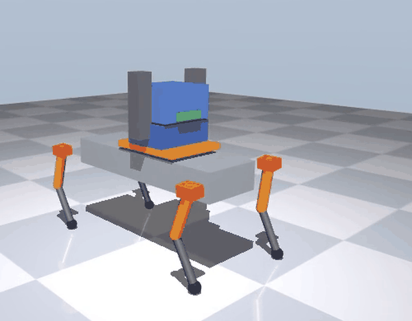
</p>

*MuJoCo simulation, WALK station — one crawl cycle of three, sped up. The blocky look is the model: the geoms
are primitives; the masses and inertias behind them are measured off the STEP solids for the printed
parts, with the servos, packs, arms and compute stack entered as nominal box and point masses.*

<p align="center">
  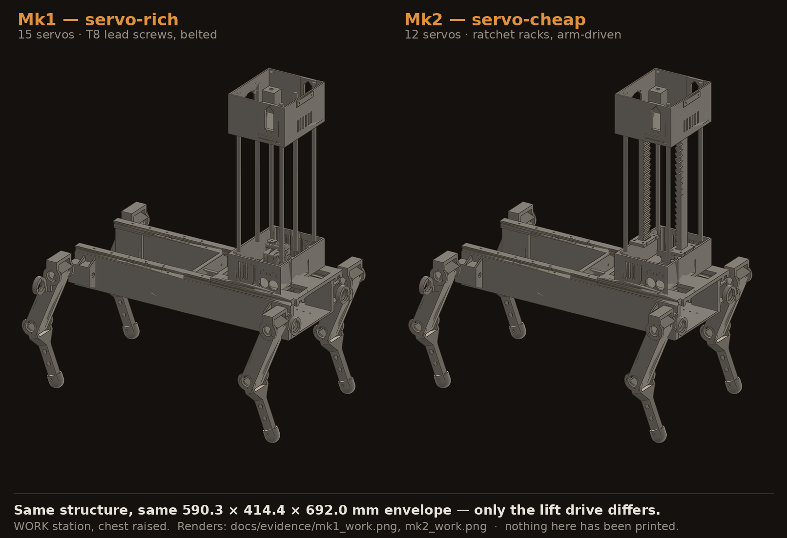
</p>

*CAD renders of the two variants at the WORK station, chest raised — Mk1 (servo-rich) left, Mk2
(servo-cheap) right, the same 590.3 × 414.4 × 692.0 mm envelope. Renders, not photographs.*

**A centaur robot designed to be fully 3D-printed — a quadruped chassis carrying a telescoping torso — written as parametric Python, simulated from the same CAD, and gated part by part.**

[Results](#results) · [Architecture](#architecture) · [Engineering highlights](#engineering-highlights) ·
[Status](#status) · [Quick start](#quick-start) · [Build order](BUILD.md) · [Evidence index](docs/EVIDENCE.md)

| at a glance | |
|---|---|
| code | **17 586** lines of Python, **54** modules, **181** `assert` gates |
| simulation | WALK crawl **145.0 mm**, 3 cycles, **0 falls**, **15.0 mm** min three-foot support margin |
| model | **4.9734 kg** — the printed parts' mass, CoM and inertia measured off their 20 STEP solids; servos, packs, arms and compute stack as nominal box/point masses (about half the total) |
| hardware | **none.** Nothing printed, nothing assembled, no motor has turned |

---

## What it is

Parametric CAD written in Python ([build123d](https://github.com/gumyr/build123d), STEP out) for a
quadruped whose waist carries a rail: slide the torso back and it is a walking machine, slide it
forward and it is a workbench that reaches. There is no CAD application in the loop — the parts, the
assembly, the analyses, the MuJoCo export and the crawl simulation are all code.

The simulation model is **generated from the CAD**, not hand-typed: `sim/mjcf_export.py` reads every
part's STEP solid, takes mass and inertia off the geometry, and snapshots all 20 STEP files plus
every constant it used into a provenance file that the simulator then checks for drift. To be precise
about which half is generated: the collision and visual geoms are primitives sized from the same
`interface_constants.py`, while the **mass, centre of mass and inertia of the printed parts are
measured off their STEP solids** — so that part of the dynamics, not the artwork, comes from the CAD.
What is *not* measured off a solid is entered as a nominal box or point mass and listed as such in
the provenance file: the servos (74.5 g each), the two battery packs (300 g each), the arms (two
250 g halves), the compute stack (215 g) and a 271.4 g torso remainder — 2 517.6 g, about half of the
4.9734 kg.

Two official variants share every structural part:

|  | **Mk1 — servo-rich** | **Mk2 — servo-cheap** |
|---|---|---|
| chest lift | T8 lead screws + 1 servo, belted | ratchet racks + sprung pawls, arm-driven |
| waist slide | pinion + 1 servo | two-way detent + release lever, arm-driven |
| chest yaw | 1 servo on the slew | indexed ring + pull pin, arm-driven |
| servos | 15 | 12 |
| verticals | 4: 2 rods + 2 screws on the corners | 6: 4 corner rods + 2 centreline racks |

Only the drive modules and the vertical count differ, and each drive bolts to a pattern the other
build also carries — so one machine converts to the other without reprinting structure
(`cad/alpha_centauri/marks.py:10-16`).

The "arm-driven" mechanisms in the Mk2 column are sized against the arm **spec** below, not against a
built arm — see [Status](#status).

---

## Results

Every figure in this section is drawn by `cad/alpha_centauri/sim/crawl_sim.py` on a clean checkout;
the GIF is a hand cut from the MP4 that same run writes. Three figures *elsewhere* on this page are
**not** redrawn by any code here — the hero composite at the top and the two arm-spec images — and
[docs/EVIDENCE.md](docs/EVIDENCE.md) names each one and says what it is.

Rebuilding the parts, re-exporting the MJCF and re-running the crawl reproduces
[`docs/evidence/sim_results.json`](docs/evidence/sim_results.json) to the reported precision — all
four runs' minimum three-foot support margins and all four deficient-contact percentages matched
**exactly**, as did six of the WORK recovery calculation's eight fields; twenty values moved in
their last digit (solver noise, each one listed in [docs/EVIDENCE.md](docs/EVIDENCE.md)). The
simulation stage takes **26 s** (45 s on a cold first run).

### 1. The crawl works at the WALK station

| | |
|---|---:|
| distance covered | **145.0 mm** of a 150 mm script |
| cycles / falls | 3 / **0** |
| min three-foot support margin | **15.0 mm** |
| time on fewer than three feet | **0.0 s (0.0 %)** |
| IK↔FK closed-loop grid error | 1.67 × 10⁻⁹ m |

*The crawl itself is the GIF at the top of this page — one cycle of the three in this run.*

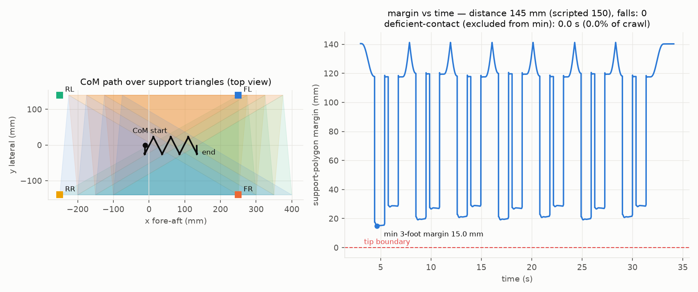

*Left, the CoM path over the three-foot support triangles of the WALK crawl; right, the support
margin against time. Drawn by `crawl_sim.py` from the committed run.*

<details>
<summary><b>Eight mid-phase frames of cycle 2 of 3 at the WALK station</b></summary>

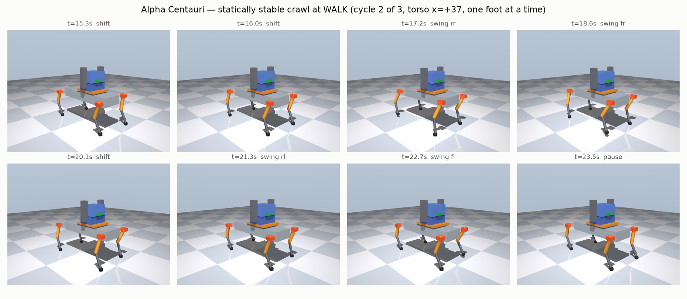

*Eight mid-phase frames of cycle 2 of 3 — the shifts, the four swings and the end pause — as
rendered by MuJoCo, each titled with its time and phase. The support triangles and the CoM path are
drawn in the figure above this one, not on these frames.*

</details>

Evidence: [`docs/evidence/sim_results.json`](docs/evidence/sim_results.json) →
`runs.walk_chest.crawl` · figures regenerated by `cad/alpha_centauri/sim/crawl_sim.py`.

### 2. The torque budget

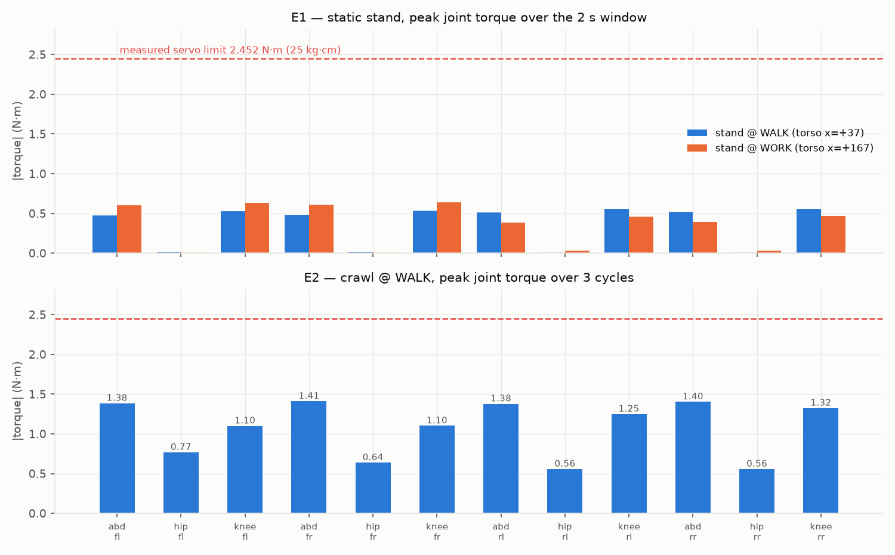

*Peak joint torque at the static stand and over the WALK crawl, against the 2.4517 N·m measured
servo limit. Drawn by `crawl_sim.py` from the committed run.*

Peak joint torque over the WALK crawl is **1.41 N·m — 57 % of the 2.4517 N·m (25 kg·cm) MEASURED
servo limit**, with no joint saturated. The 50 kg·cm datasheet peak is never used as a limit in the
chassis, leg or crawl analysis: a stall rating is not a duty rating. One constant, at
`cad/alpha_centauri/hand_load.py:47`, and the whole crawl and hand-load chain divides by it.
(The v1 arm spec is the one place that does size against the stall rating — stated where it is
[shown below](#engineering-highlights), because it is an inconsistency in that spec, not a result.)

`kp` is an assumption rather than a measurement, so it is swept. At kp 280 instead of the assumed 60,
all four knees touch the torque limit for 0.1–0.2 % of the crawl while the margins barely move (WALK
16.6 mm, WORK 2.4 mm) — recorded in the results file as `saturated_joints_frac`, not left implicit.
What does *not* hold still is WORK's time off three feet: **16.9 % at kp 60 against 4.5 % at kp 280**,
a 3.7× move. Reporting the number that moves beside the one that does not is the only version of this
sweep worth publishing.

**One caveat on that sweep, because it is the discipline this page sells.** The kp-280 runs are 2
cycles. The WORK baseline is also 2 cycles, so the WORK pair is a controlled comparison; the WALK
baseline is 3 cycles, so the WALK pair changes gain *and* run length together and part of
15.0 → 16.6 mm is the shorter run, not the stiffer gain. The confound is recorded at
`cad/alpha_centauri/sim/crawl_sim.py:696` and in [docs/EVIDENCE.md](docs/EVIDENCE.md).

### 3. The WORK station fails exactly as the layout predicted

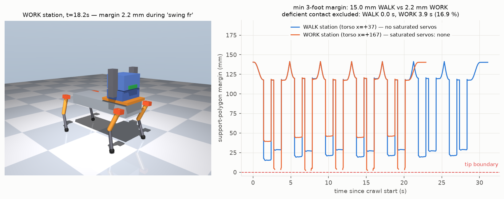

*The WORK station at its worst margin, beside both stations' margin traces. Drawn by `crawl_sim.py`
from the committed run.*

| | WALK | WORK |
|---|---:|---:|
| min three-foot margin | 15.0 mm | **2.2 mm** |
| time on two planner-stance feet | 0.0 s (0.0 %) | **3.9 s (16.9 %)** |
| peak crawl torque | 1.41 N·m (57 %) | **2.00 N·m (81 %)** |
| saturated joints | none | none |

Two-foot samples have no support polygon at all, so they are excluded from the minimum and reported
separately rather than hidden. Recovering WALK's margin at WORK would take a **45.2 mm** lateral CoM
shift, which costs **263.98 mm of leg extension = 98.4 % of reach**, past the 260.09 mm guard. The
legs cannot buy back what the forward CoM spends — so the crawl is gated to WALK, and the sliding
waist rail is a *mode switch*, not a convenience.

### 4. The compute placement was settled by an A/B, not an argument

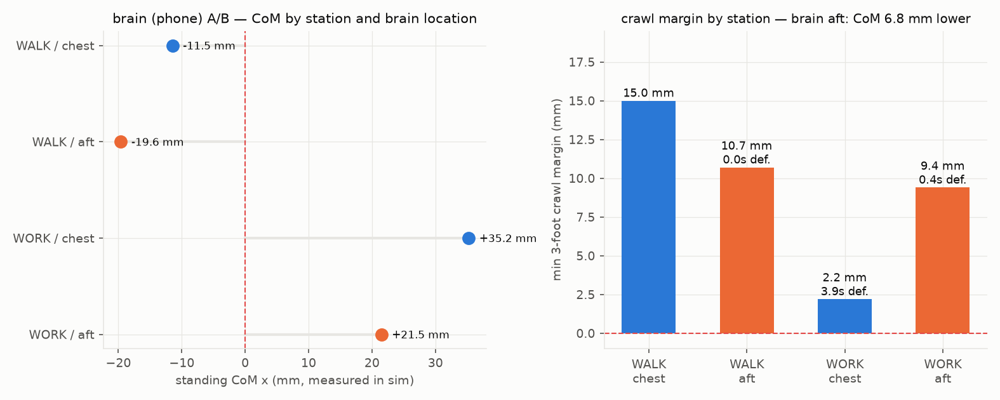

*Standing CoM by station and compute placement, and the crawl margin each placement gives. Drawn by
`crawl_sim.py` from the committed runs.*

Where the phone/compute stack sits was decided by exporting it as a model variant and measuring:
moving it aft drops standing CoM x by **8 mm at WALK** (−11.5 → −19.6) and **14 mm at WORK**
(+35.2 → +21.5), lifting the WORK crawl margin from **2.2 mm to 9.4 mm** at the cost of 4.3 mm of
WALK margin (15.0 → 10.7 mm). One component changed, both variants run against the same script.

---

## Architecture

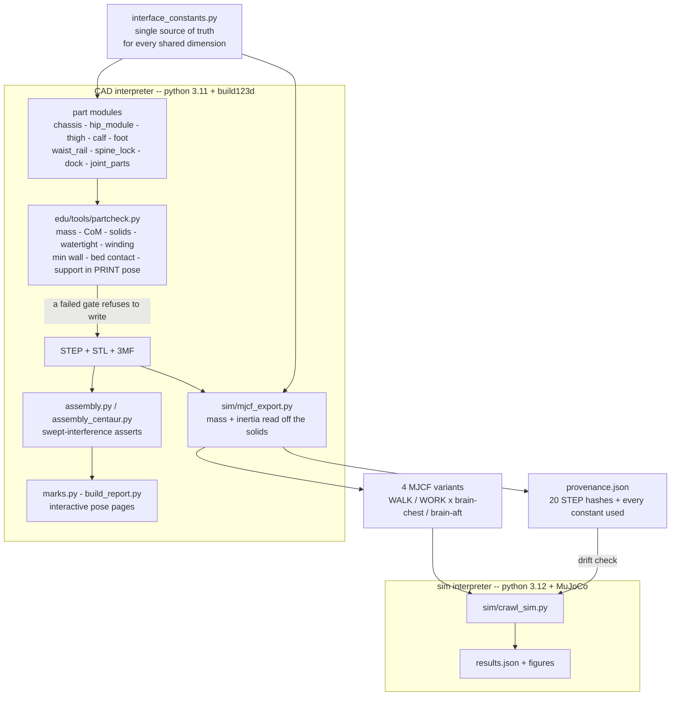

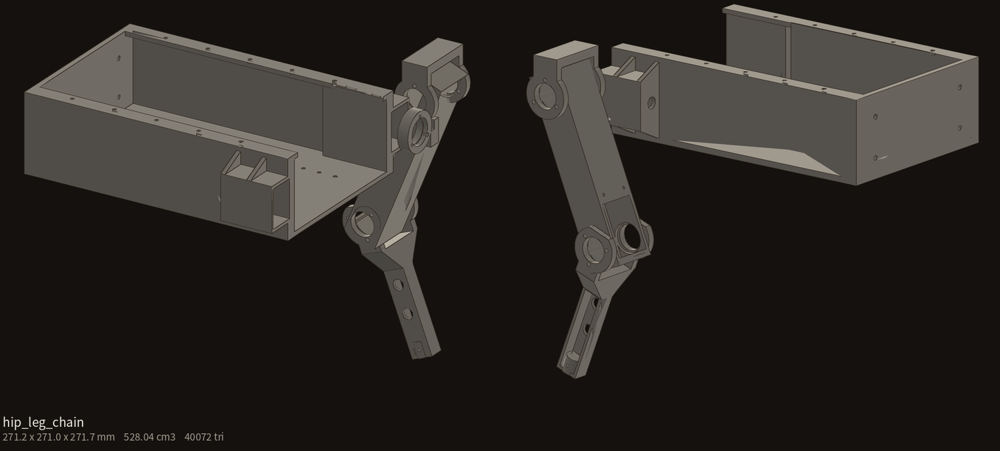

*The leg chain — chassis half, hip module, thigh, calf — 271.2 × 271.0 × 271.7 mm, 528.04 cm³, as
measured on the render's own canvas ([`docs/evidence/hip_leg_chain_hero.png`](docs/evidence/hip_leg_chain_hero.png)).
The link lengths and the IK come from the MIT-licensed DingoQuadruped project, with one deliberate
departure: the knee is driven directly instead of through the donor's hip-mounted four-bar.*

**Why the model is generated.** A hand-typed MJCF is a second copy of the design, and a second copy
drifts. The exporter instead measures each STEP solid, so the model's total mass is an output, not an
input: it lands at **4.9734 kg** against a parts ledger of about **4.505 kg**, and the **+468 g** delta is
computed and recorded — with its cause named — rather than quietly reconciled. All three numbers, the
20 STEP hashes and every constant the export used are in
[`docs/evidence/provenance.json`](docs/evidence/provenance.json).

**Why the two interpreters never mix.** build123d/OCCT and MuJoCo want different pins. The seam is
files on disk — STEP in, MJCF and a provenance JSON out — so neither lane can import the other's
dependency tree by accident.

**Why the provenance snapshot exists.** `crawl_sim.py` treats the snapshot as the authority for the
XML it accompanies, and warns if the live constants have moved since the export. Without it, a
simulation result silently becomes a claim about a robot that no longer exists.

---

## Engineering highlights

**A 500 mm robot on a 180 mm bed.** The chassis is split into four quarters with keyed splices — and
the bed gate *still* refused the outer quarter, because the abduction pods pushed it to 208.3 mm in
Y, and no orientation or diagonal saves that. The fix was to make the pods bolt on. Every chassis part
now passes on a **measured** bounding box in its print pose: inner quarter 125.0 × 160.0 × 72.0 mm at
180.2 g / 3.4 % support, outer quarter the same envelope at 229.4 g / 3.0 %, splice key
11.6 × 11.7 × 5.7 mm (its print-pose box; the render below lists the same key as 5.7 × 11.7 × 11.6),
abduction pod 72.0 × 34.2 × 70.0 mm at 43.9 g.

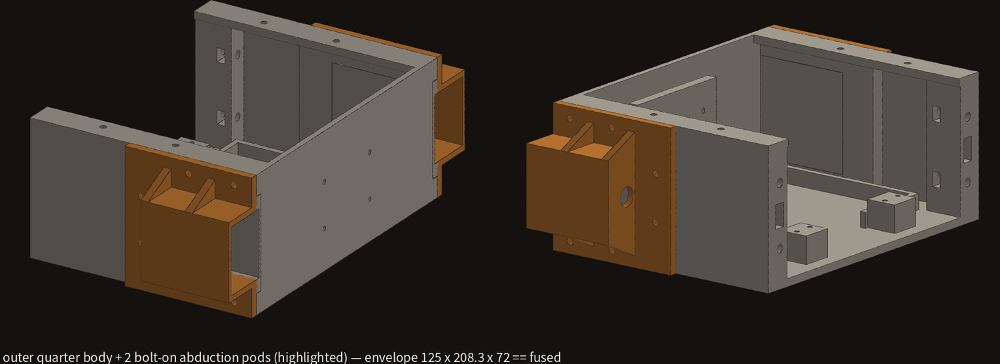

*The outer quarter with both pods attached (orange): the 125 × 208.3 × 72 mm envelope that fits the
180 mm bed in no orientation when printed as one piece. The pods now bolt on, and each part passes
the bed gate on its own measured box.*

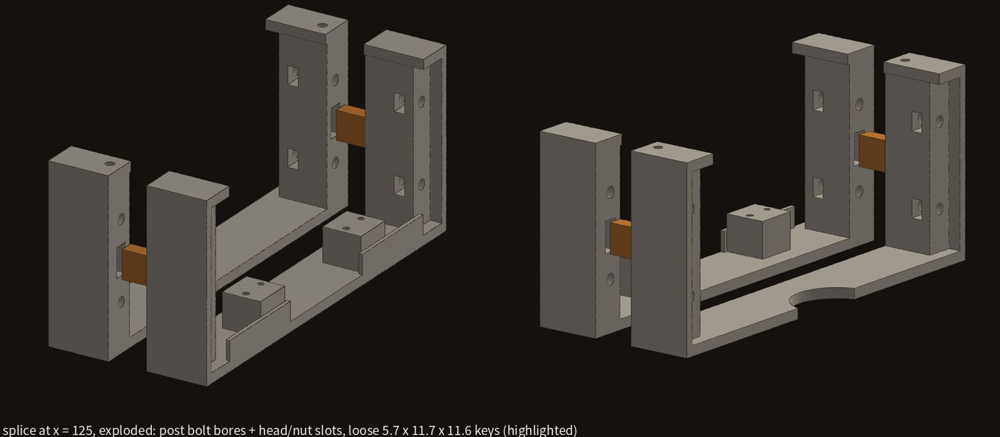

*The splice at x = 125, exploded: post bolt bores, head and nut slots, and loose
5.7 × 11.7 × 11.6 mm registration keys. The bolts clamp; the keys locate.*

**Splitting a 288 mm ratchet rack without changing what the pawl feels.** No orientation fits 288 mm
on a 180 mm bed. The rack is split 12 + 12 teeth at the tooth-12 root plane, and the gates assert
**parity against a monolithic reference part**: the pawl fully seated on teeth 5, 11, 12 and 18 gives
0.000 mm³ on both the assembled and the monolithic rack; a 49-pose deflected sweep and a 21 × 49-pose
release sweep across the seam both come back 0.0000 mm³. The seam adds nothing and removes nothing
the pawl can feel, so the full **250 mm stroke** survives where the diagonal fallback would have cost
about 50 mm. One thing those sweeps do not test: in the shipped geometry the pawl's leaf spring is
fused to its carrier and cannot deflect, so every "deflected" pose is a rigid translation of the
whole pawl — see [Status](#status).

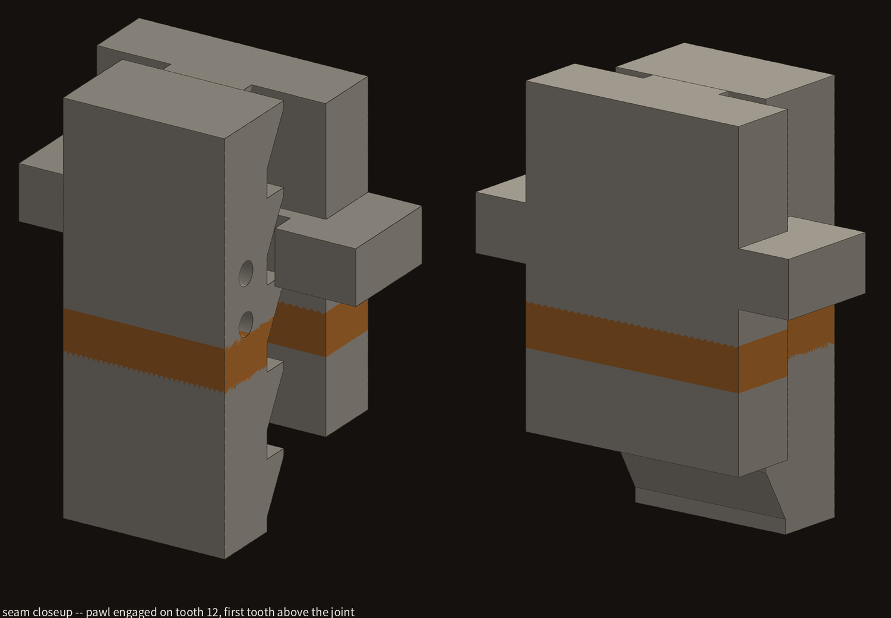

*The pawl engaged on tooth 12, the first tooth above the 12 + 12 seam.*

**Grade printability in the pose the part actually prints in.** The waist carriage read **24.1 %
support** until it was graded in its real print pose; flipped, **0.5 %**, with bed contact going from
4 000 to 24 511 mm² (`cad/alpha_centauri/build_report.py:209-211`). The checker also excludes first-layer
facets — on the chassis alone, counting them turned a real 4.8 % support requirement into a
meaningless 23.4 % (`edu/tools/partcheck.py`, "THE FIRST-LAYER TRAP").

**Anything that moves gets a permanent swept-interference assertion.** Single-part checks are blind to
assembly: a calf once sat **1.62 cm³** inside a thigh and passed everything else
(`cad/alpha_centauri/calf.py:158`). The foot is now swept 0–54.4° across 8 azimuths — the angle is
itself computed, not chosen (37.94° of swing + 11.48° of contact patch + 5° of margin) — and reports
**2.71 mm** minimum TPU-to-PETG ground clearance at 55° of tilt, i.e. only the TPU ever touches down.
The stowage study records **0.0 mm³** swept interference in the free case and **1856.1 mm³** in the
full case in [`docs/evidence/stowage_summary.json`](docs/evidence/stowage_summary.json), rather than
one of them being quietly dropped — **and the 1856.1 no longer reproduces.** Rebuilding the whole
chain and re-running the study returns **0.0 mm³ in both cases**, at 8, 14 and 28 sweep samples; the
other 13 fields in that file come back identical. The probe intersects only the chassis halves and
the rail rack, so one of those two has moved since the study was last run, and neither old solid is
committed. The evidence file is left exactly as it was recorded and the discrepancy is written down
instead, here and in [docs/EVIDENCE.md](docs/EVIDENCE.md). Note also what that probe does *not*
cover: the dovetail ways are not in its obstacle set, so the 1.00 mm vertical-to-way overlap listed
under [Status](#status) is computed by `way_clash()`, not found by the sweep.

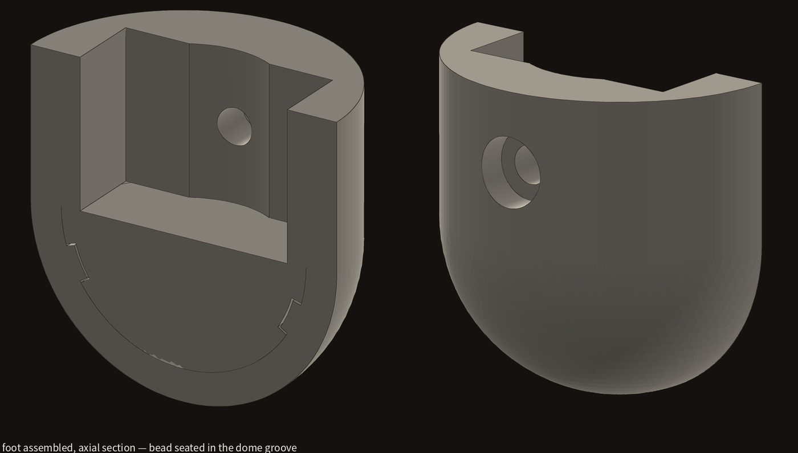

*Axial section of the assembled foot: the 0.8 mm TPU bead seated in the PETG dome groove.*

The foot itself is two parts — an 8.9 cm³ PETG core and a 3.6 cm³ TPU tread — retained by a 0.8 mm
bead snapping into a dome groove that develops **10.4 mm³** of solid interference against a 1.0 mm
pull-off, then bonded with a flexible adhesive. Snap *plus* adhesive, never adhesive alone.
12.8 g per foot, 51.4 g for four. `foot.py` prints `ALL GATES GREEN` in ~35 s cold, ~18 s warm on a
laptop — and prints `FAIL watertight` twice on the way there, which is expected and explained in
[Status](#status).

**`L1` is a diagonal — do not use it as a lateral offset.** The donor's `L1 = 51.62024721 mm` is the
hypotenuse of a link
that goes 49.60 mm **outboard and** 14.30 mm **up** at the same time. Using the hypotenuse as a
lateral offset drew the robot 14.3 mm too tall and overstated the track by 4.04 mm. Both primitives
and the derived value now live in one file with the trap written beside them
(`cad/alpha_centauri/interface_constants.py:55-84`) — because a shared dimension assumed in two
places is a latent bug.

**Sizing by the real load case, and admitting a missed target.** The arm spec sizes joints against the
*press*, not the 200 g hold, and its own mass-budget panel is titled "target MISSED by 80 g".

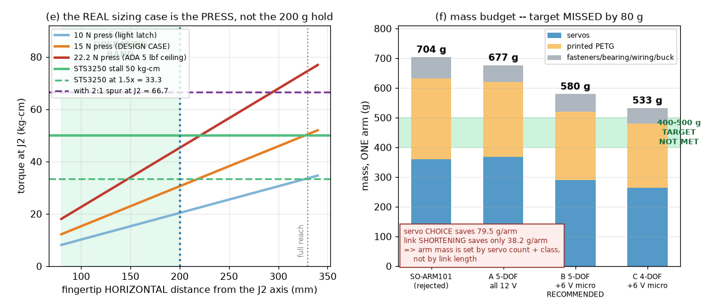

**And the spec contradicts the servo rule two sections up, so it is stated rather than tidied away.**
Panel (e) sizes the arm's J2 against the STS3250 **stall** rating of 50 kg·cm derated 1.5× to
33.3 kg·cm, and panel (d)'s verdict — "all 6 joints PASS at ≥ 1.5×" — is computed against that same
stall bar. 33.3 is *above* the 25 kg·cm measured sustained figure the crawl and hand-load analyses
use. That is an open inconsistency in the v1 arm spec — it is a sizing sheet, not a result — and it is
one reason the arm is listed under "Does not" in [Status](#status). Re-running it against 25 kg·cm is
the next step, and panel (e) says roughly what that will cost: the 15 N design press already reaches
the 33.3 kg·cm bar near the 200 mm working radius.

<details>
<summary><b>The full six-panel arm spec sheet</b> — links, reach, spine budget,
static torque, press case, mass budget</summary>

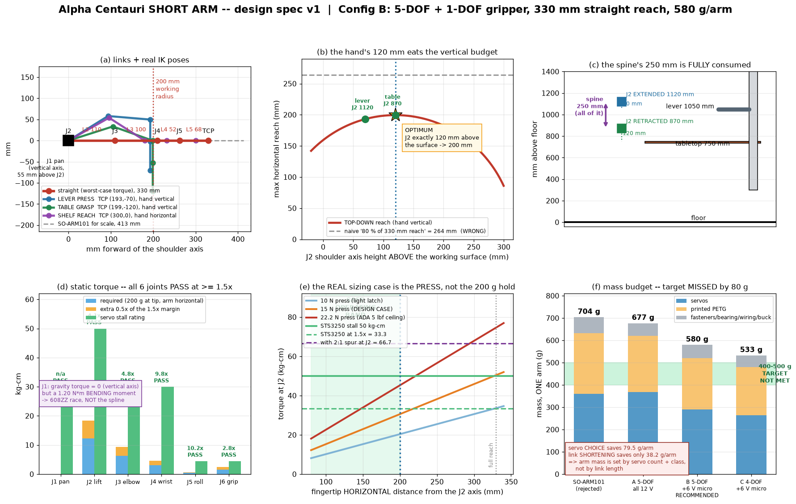

</details>

**An eight-part charging dock, gate-passed.** Funnel, two-piece column, base, tag mast, contact probe,
and a sprung pack sled and latch — all inside a 180 mm cube on measured bounding boxes: largest part
178.0 × 100.0 × 8.0 mm, heaviest 141.9 g, worst support fraction 5.4 %. The gates cover fit and the
sled and latch motions; docking yaw error and leg swing during the back-in are not swept, and no
power connector or charge electronics are drawn (`cad/alpha_centauri/dock.py`, "Yaw error was not
swept").

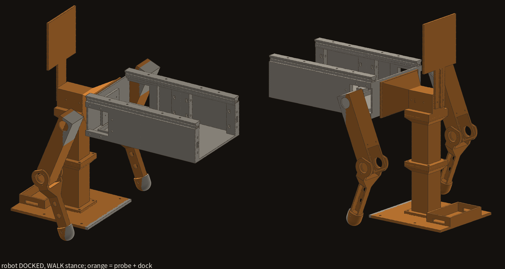

*The robot docked at the WALK stance; orange is the dock and the contact probe.*

---

## Status

**Works**
- 17 586 lines of Python across 54 modules; 181 `assert` statements, 167 of them in
  `cad/alpha_centauri/`, refusing to write a STEP when a gate fails.
- Every chassis, leg, foot, rail, spine and dock part passes its gates on **measured** geometry —
  the gates as written, which is not the same as the part being right; the known defects they do
  not catch are under "Does not". `spine_lock.py` and `foot.py` print `ALL GATES GREEN`; `dock.py`
  prints `ALL GATES PASS`.
- **Two gate lines print `FAIL` inside that green run, on purpose.** `partcheck`'s watertight probe
  cannot pass a sphere — the pole fan leaves zero-length edges — so both foot solids print
  `FAIL watertight`, `foot.py` proves closure independently (`assert_closed`, `foot.py:537` and
  `:748`) and the run still ends `ALL GATES GREEN` with exit 0. `chassis.py` likewise prints
  `WARN bed contact (136 mm², want ≥ 150)` on the 0.7 g splice key. Nothing is swept up; the word
  `FAIL` simply costs more than it should here, and that is the next thing to fix in `partcheck`.
- The statically stable crawl at WALK is simulated and reproducible from a clean checkout.
- Measured off the assembly: 199.0 mm ride height, a 500 × 279.2 mm foot footprint, legs at
  249.30 mm extension = 93.0 % of a 268.14 mm reach.

**Does not**
- **Nothing has been printed. Nothing has been assembled. No motor has turned.** There is no hardware
  result of any kind in this repository, and the crawl exists only in MuJoCo.
- There is **no unit-test suite**. The gates *are* the tests, and that is how they should be read: a
  part module either exits 0 having written its STEP, or it raises.
- Standing height is **671 mm** extended against an **850 mm** target — 179 mm short, and
  `assembly.py` prints the shortfall rather than moving the target.
- Every part with a servo pocket — the abduction pod, the thigh and the hip module — is
  **PRINT-BLOCKED** on one caliper measurement (servo height 35.00 vs 37.80 mm). Each is parametric
  and gated at both values, and each module prints the block on its last line
  (`chassis.py`, `thigh.py:282`, `hip_module.py:566`); none is printable until the real number is
  known.
- **The thigh has a known defect.** Its upper cover-bolt pair is cut in air — at z = 149.40 against a
  part top of 146.00 — so the cover is held only at its lower pair, and no in-envelope relocation
  exists. `thigh.py:285` prints this as `KNOWN DEFECT`; the fix is deferred to the hip-pitch-cavity
  rework.
- **The spine pawl's leaf spring cannot bend.** In the shipped geometry the leaf is fused to its
  carrier over its whole 40 mm length, so the seam-parity sweeps above translate the pawl rigidly
  rather than flexing it. The carrier needs a relief pocket behind the leaf before the ratchet can
  work (`spine_lock.py` docstring, "FOLLOWUPS").
- **The chest verticals are not stowed.** As drawn they stand **250 mm proud** of the closed chest.
  `extension_stowage.py` measures a **1.00 mm interference** between a vertical and the dovetail
  ways over a 12 mm z band — `way_clearance_mm: -1.0` in
  [`docs/evidence/stowage_summary.json`](docs/evidence/stowage_summary.json) is an overlap, not a
  margin — which costs a 2 mm inboard shift of the verticals and the chest tower bores. Trimming
  the 37 mm of dead rod and running them into the body then still leaves **77 mm** of overhang, so
  the study's own recommendation buys it back with **+77 mm of permanent waist height**
  (`waist_growth_needed: 77.0`) — a cost the closed pose pays whether the chest is up or down.
  Neither the 2 mm shift nor the taller waist is drawn in the shipped geometry.
- **The arms and head are not designed.** `cad/shortarm/` is a single design-spec figure — no
  geometry, no code — there is no arm or head part module anywhere in `cad/alpha_centauri/`, and the
  simulation carries the arms as **two nominal 250 g boxes** with the head and the feet omitted from the
  mass model entirely (`sim/SIM-NOTES.md`, "What sim CANNOT see"). Mk2's three "arm-driven"
  mechanisms are sized against that spec, not against a built arm.
- The WORK station cannot crawl, and is not meant to (see Results 3).
- `cad/tonypi_tall/` is **not runnable out of the box**: it reads HiWonder's own CAD, which is not
  redistributed here. Everything else runs from this checkout alone.

**Next**
Caliper the servo → print the 37 cm³ fit gauge → plate 1.

---

## Quick start

Two interpreters, never mixed (see Architecture):

```bash
# CAD lane — python 3.11
python3.11 -m venv edu/.cadenv
edu/.cadenv/bin/pip install build123d trimesh rtree numpy matplotlib pillow

# simulation lane — python 3.12, a SEPARATE venv
python3.12 -m venv .venv
.venv/bin/pip install "mujoco>=3.12" "numpy<2.4" "imageio[ffmpeg]" matplotlib
```

Order matters, and a clean checkout will not survive being run out of order — see
[BUILD.md](BUILD.md) for the full dependency graph and the failure each shortcut produces.

```bash
# smoke test: one part, all its gates. ~35 s cold, ~18 s warm.
./smoke_test.sh

# the geometry lane
for m in chassis thigh calf joint_parts hip_module waist_rail spine_lock foot dock; do
  edu/.cadenv/bin/python cad/alpha_centauri/$m.py || break
done
for m in waist_box chest_box spine_base leg_linkage; do
  edu/.cadenv/bin/python cad/telescopebot/$m.py || break
done
edu/.cadenv/bin/python cad/alpha_centauri/assembly.py
edu/.cadenv/bin/python cad/alpha_centauri/assembly_centaur.py
edu/.cadenv/bin/python cad/alpha_centauri/build_report.py        # interactive pose page
edu/.cadenv/bin/python cad/alpha_centauri/marks.py work          # interactive pose page
edu/.cadenv/bin/python cad/alpha_centauri/extension_stowage.py   # stowage study

# the simulation lane
edu/.cadenv/bin/python cad/alpha_centauri/sim/mjcf_export.py     # CAD -> MJCF + provenance
MUJOCO_GL=glx .venv/bin/python cad/alpha_centauri/sim/crawl_sim.py
```

`marks.py` and `build_report.py` write interactive HTML pages to `cad/alpha_centauri/output/` with
pose sliders — drag the chest up and down, slide the waist between WALK and WORK, drag individual
parts. Generated STEP/STL/3MF/HTML are deliberately **not** committed (~200 MB per rebuild); the
design is the Python, and [`docs/evidence/`](docs/evidence/) is the curated proof set.

**External dependencies**, all installed from their own upstreams, none vendored here:

| | licence | where |
|---|---|---|
| build123d (+ OCCT) | Apache-2.0 / LGPL | <https://github.com/gumyr/build123d> |
| MuJoCo | Apache-2.0 | <https://github.com/google-deepmind/mujoco> |
| trimesh, rtree | MIT | PyPI |
| numpy, matplotlib, imageio, pillow | BSD / PSF | PyPI |
| HiWonder TonyPi CAD — `cad/tonypi_tall/` only | vendor, not redistributed | your own download |

`cad/tonypi_tall/` is the one corner that does not run from this checkout alone. Point
`TONYPI_STOCK_STEP_DIR` and `HIWONDER_CAD_DIR` at your own copy of HiWonder's CAD;
`cad/tonypi_tall/vendor_paths.py` reads both and fails with a message naming
[THIRD_PARTY_NOTICES.md](THIRD_PARTY_NOTICES.md), which lists every removed file and where to get
it. `fit_gauge.py` is the exception — it builds from primitives and needs nothing.

MuJoCo rendering needs a GL context. On the laptop these results were measured on, `MUJOCO_GL=glx`
with a live `DISPLAY` works and `egl` does not; `xvfb-run -a` is the headless fallback.

---

## The rules this project runs on

Each of these was paid for once already, and each now cites the file that proves it.

1. **Grade printability in the PRINT orientation.** Same part, 24.1 % support vs 0.5 %.
   → `cad/alpha_centauri/build_report.py:209-211`, `edu/tools/partcheck.py`
2. **Anything that moves against another part gets a permanent swept-interference assert.**
   Single-part checks are blind to it; a calf once sat 1.62 cm³ inside a thigh and passed everything
   else. → `cad/alpha_centauri/calf.py:158`, `assembly.py`, `foot.py`
3. **25 kg·cm is the only measured servo figure**, and the crawl and hand-load analyses divide by it —
   a stall rating is not a duty rating. → `cad/alpha_centauri/hand_load.py:47`
   *(The v1 arm spec breaks this rule and sizes on the 50 kg·cm stall derated to 33.3. Recorded above,
   not quietly fixed.)*
4. **`L1` is a diagonal**, 49.60 mm outboard *and* 14.30 mm up. Using the 51.62 hypotenuse as a
   lateral offset drew the robot 14.3 mm too tall. → `cad/alpha_centauri/interface_constants.py:55-84`
5. **Never restate a shared dimension — import it.** `interface_constants.py` exists because a servo
   horn's screw circle was once assumed rather than measured.
6. **Every claim ships a picture.** A number without an image is not evidence.
   → [`docs/evidence/`](docs/evidence/), [`docs/EVIDENCE.md`](docs/EVIDENCE.md)

---

## Also in this repository

- **`cad/telescopebot/`** — the donor torso the centaur inherits: chest box, waist box, spine base,
  and the leg linkage that the Dingo-derived leg superseded. Its `VERIFICATION.md` is a part-by-part
  printability audit.
- **`cad/tonypi_tall/`** — a TALL variant of a HiWonder TonyPi frame. All the *code* here was written for
  this project; the vendor geometry it reads is not redistributed. The print test is deliberately designed as an
  A/B, because two variables change at once — plastic instead of aluminium, and new geometry — so
  unmodified stock parts go on the plate alongside the redesigned ones to isolate the material.

  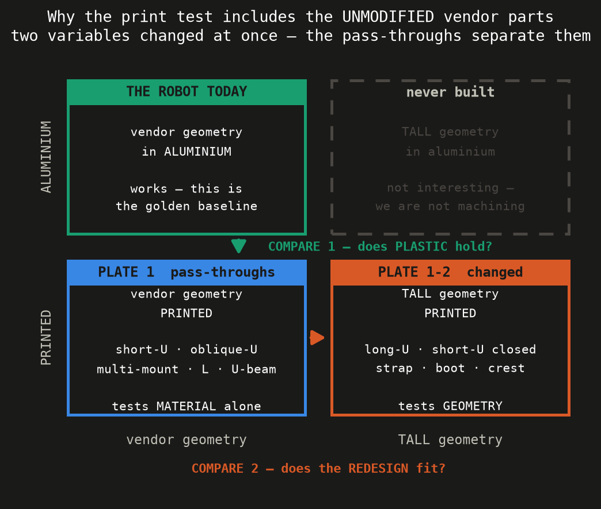

  Before anything structural goes on the bed, a 37 cm³ **fit gauge** measures the four things the
  design depends on: a ladder of servo-channel widths (21.04 / 21.44 / **21.64** / 22.04 mm)
  straddling the design clearance the code derives, four hole diameters, free-standing **2.52 and
  1.68 mm** walls, and a 110.00 × 56.00 × 5.00 mm shrinkage plate. Tolerance is a property of
  material + machine + orientation, so it gets measured on that stack rather than assumed.
  (`fit_gauge.py` estimates ~20 min to print it. That is an estimate for a print that has never
  happened, not a measurement — the volume and every dimension above are measured off the solid.)
- **`edu/`** — the design documents, the tooling (`partcheck.py`, `hero_render.py`,
  `render_step.py`), and the slicer profiles. `ALPHA-CENTAURI-PLAN.md` is partly superseded by
  `REPLAN-2026-08-28.md`, and both are kept with the supersession banner intact.

---

## License

**All rights reserved. No licence is granted.** Beyond the rights GitHub's Terms of Service grant to
visitors of a public repository, you may not copy, modify, distribute, sublicense, publish, create
derivative works from, or train machine-learning models on any part of this repository without
prior written permission. See [LICENSE](LICENSE).

Third-party material — the MIT-licensed Dingo leg kinematics this design derives from, and the vendor
CAD and datasheets that are deliberately **not** included in this public copy — is listed in
[THIRD_PARTY_NOTICES.md](THIRD_PARTY_NOTICES.md), along with where to obtain each removed item.
